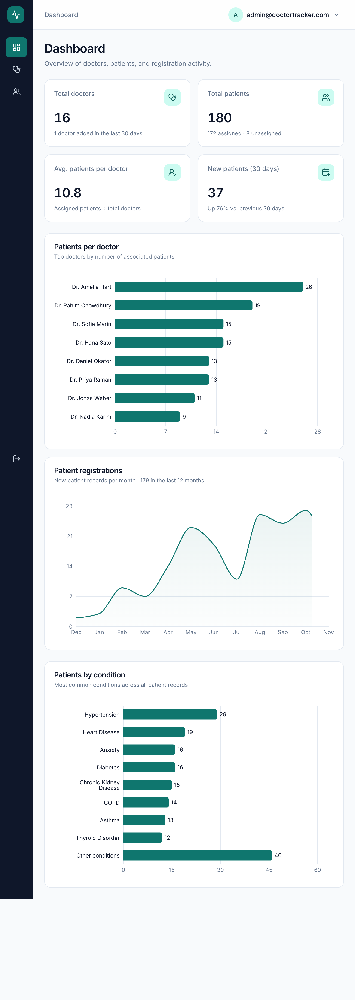
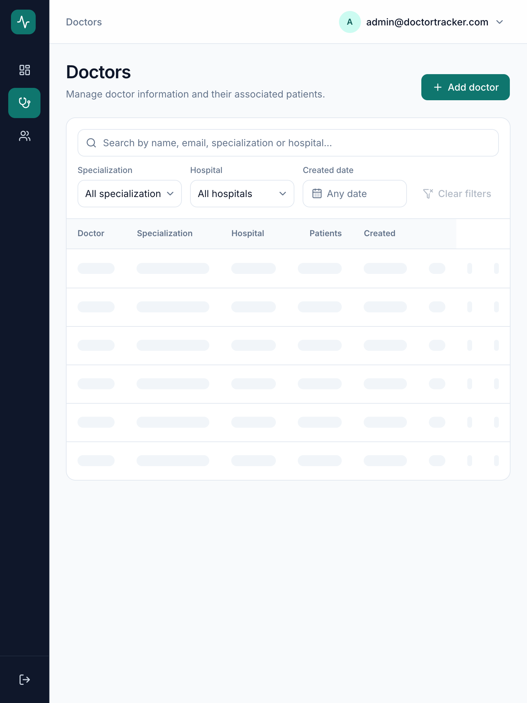
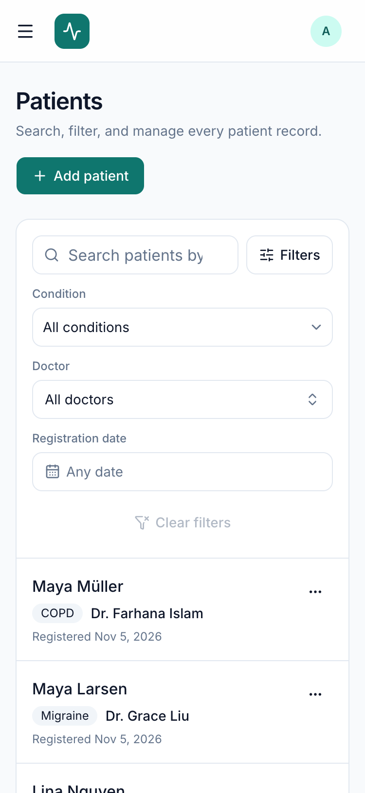
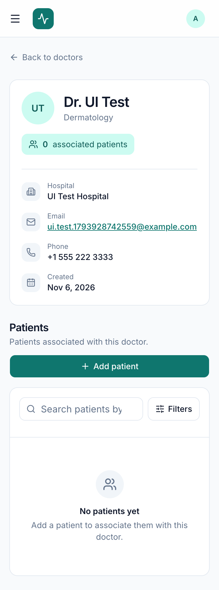

# DocTrack

**DocTrack is a hospital operations platform: a public website where visitors find specialists, and a secure portal where administrators, management, front-desk staff and doctors manage the care network.** Administrators sign in, register doctors, add patients under a doctor, browse every patient record with search, filters and pagination, and follow patient distribution and registration trends on a live dashboard backed by MongoDB aggregations.


---

## Features

- **Public website** – homepage with a video hero, live network statistics (refreshed every 30 s from the database), services, featured doctors, about and contact sections, plus a searchable **Find a doctor** directory and public doctor profiles. All content is editable by administrators in **Site settings**; only public doctor fields (name, specialization, hospital) are exposed.
- **Roles** – Administrator, Management, Front desk (staff) and Doctor, enforced by capability permissions on every API route; menus and actions adapt to the signed-in role. Administrators manage accounts on the **Users** page.
- **Authentication** – administrator login with hashed passwords, server-side sessions in an `httpOnly` cookie, logout that revokes the session, rate-limited sign-in, protected pages and APIs.
- **Dashboard** – total doctors, total patients, average patients per doctor, new patients in the last 30 days (with trend), patients-per-doctor chart, monthly registration chart (6/12/24-month period), patients-by-condition chart, recently added patients. All numbers are computed in MongoDB.
- **Doctors** – add doctors, list with server-side search (name, email, specialization, hospital), specialization / hospital / created-date filters, sortable columns, pagination, patient count per doctor, doctor details page with breadcrumbs.
- **Doctor's patients** – list, search and filter a doctor's patients, add a patient under the doctor, remove a patient from the doctor (the record is kept as *unassigned*), edit and delete.
- **Patients** – global directory with search, condition / doctor (including *Unassigned*) / registration-date filters, pagination, create, edit (including reassignment) and delete with confirmation.
- **Responsive UI** – persistent sidebar on desktop, icon rail on tablet, drawer navigation and card lists on mobile, collapsible filters, no horizontal scrolling.
- **States everywhere** – loading skeletons, empty states, error states with retry, toast feedback, inline form validation.

## Technology stack

| Layer | Technology |
|---|---|
| Frontend | Next.js 16 (App Router), React 19, TypeScript |
| Styling / UI | Tailwind CSS 4, shadcn/ui (Radix), Lucide icons |
| Data fetching | TanStack Query |
| Forms / validation | React Hook Form, Zod |
| Charts | Recharts |
| Notifications | Sonner |
| Backend | Node.js 22, Express 5, TypeScript |
| Database | MongoDB Atlas, Mongoose 9 |
| Security | bcryptjs, helmet, express-rate-limit, cookie-parser, CORS |

## Architecture

```text
Browser ──► Next.js (frontend, :3000)
              │  pages, components, TanStack Query
              │  /api/*  ── rewrite (same origin) ──►  Express API (backend, :4000)
              │                                          routes → controllers → services → Mongoose models
              │                                          requireAuth middleware on every private route
              ▼                                                         │
        proxy.ts: redirects signed-out visitors to /login               ▼
                                                                  MongoDB Atlas (doctor_tracker)
```

```text
doctor-tracker/
├── backend/                     Express REST API
│   └── src/
│       ├── config/              env validation, database connection
│       ├── constants/           session settings, preset conditions
│       ├── controllers/         HTTP layer: parse input, call services, send responses
│       ├── middleware/          requireAuth, central error handler
│       ├── models/              Admin, Session, Doctor, Patient (+ indexes)
│       ├── routes/              /api/auth, /api/doctors, /api/patients, /api/dashboard
│       ├── services/            business logic and database queries
│       ├── validators/          Zod schemas for bodies, params and query strings
│       ├── utils/               ApiError, response helpers, query helpers
│       ├── scripts/seed.ts      admin + demo data
│       ├── app.ts / server.ts
├── frontend/                    Next.js application
│   └── src/
│       ├── app/(auth)/login     sign-in page
│       ├── app/(dashboard)/     dashboard, doctors, doctors/[id], patients
│       ├── components/          layout, shared (table, filters, states), doctors, patients, dashboard, ui
│       ├── hooks/               URL-synced filters, debounce
│       ├── lib/                 API client, endpoints, query keys, validation, formatting
│       ├── types/               API types
│       └── proxy.ts             optimistic auth redirect
└── docs/screenshots/
```

### Data flow

1. A page component reads its filters from the URL (`?search=…&condition=…&page=2`), so filters survive refresh and back/forward navigation and can be shared.
2. TanStack Query calls `/api/...` on the same origin. Next.js rewrites the request to the Express API, so the session cookie is first-party and no browser CORS is involved.
3. Express validates the session (`requireAuth`), validates the input with Zod, and calls a service.
4. The service runs an indexed MongoDB query (filter → sort → skip/limit with a parallel `countDocuments`) or an aggregation pipeline and returns `{ success, message, data, pagination }`.
5. After a mutation the client invalidates the affected query families (patients, doctors, dashboard), so every count on screen stays consistent.

### Data model

```text
Doctor   { name, specialization, hospital, phone, email (unique), createdAt, updatedAt }
Patient  { name, condition, doctorId → Doctor | null, createdAt, updatedAt }
Admin    { email (unique), passwordHash (never selected by default), createdAt, updatedAt }
Session  { tokenHash (unique), adminId, expiresAt (TTL index) }
```

A patient belongs to **at most one doctor**. Removing a patient from a doctor sets `doctorId` to `null`: the record stays in the global directory as *Unassigned* and can be reassigned by editing it. Creating a patient always requires an existing doctor, and every doctor reference is checked before it is written.

**Indexes** (chosen from the actual queries):

| Collection | Index | Used by |
|---|---|---|
| doctors | `{ email: 1 }` unique | duplicate protection |
| doctors | `{ createdAt: -1, _id: -1 }` | default listing order, created-date filter |
| doctors | `{ specialization: 1, createdAt: -1 }`, `{ hospital: 1, createdAt: -1 }` | filtered listings, filter options (`distinct`) |
| patients | `{ createdAt: -1, _id: -1 }` | global listing, date filter, registration trend |
| patients | `{ doctorId: 1, createdAt: -1 }` | a doctor's patients, patient counts, patients per doctor |
| patients | `{ condition: 1, createdAt: -1 }` | condition filter, condition distribution |
| patients | `{ condition: 1 }` (case-insensitive collation) | canonical-condition lookup |
| sessions | `{ tokenHash: 1 }` unique, `{ expiresAt: 1 }` TTL | session lookup, automatic expiry |

## Technical decisions

**1. Separate Express API behind a same-origin Next.js rewrite.**
The specification asks for a Node.js + Express backend, so the API is its own service with a clear routes → controllers → services → models split. To avoid the usual cross-origin cookie problems (third-party cookie blocking, `SameSite=None`, CORS preflights), the browser never calls Express directly: Next.js rewrites `/api/*` to the API. The session cookie is therefore first-party with `SameSite=Lax`, and the frontend needs no tokens in JavaScript. The trade-off is one extra hop through the Next.js server, which is negligible next to the database round trip.

**2. Server-side sessions instead of JWTs.**
On login the API creates a random 256-bit token, stores only its SHA-256 hash in the `sessions` collection, and sends the token in an `httpOnly` cookie. Every private request looks the session up by an indexed hash. Logout deletes the session, so a stolen or old cookie stops working immediately, which a stateless JWT cannot guarantee without a deny-list. A MongoDB TTL index removes expired sessions automatically. The cost is one indexed read per request, which is acceptable for an admin portal. Sign-in is rate-limited, and unknown emails still run a bcrypt comparison so response times do not reveal which accounts exist.

**3. Statistics computed in the database.**
Totals use `countDocuments`. Patients-per-doctor, monthly registrations and condition distribution are aggregation pipelines that return only the small result set. Empty months are filled in on the server. The doctor list gets its patient counts from one `$group` over the doctors on the current page, not one query per doctor. No endpoint loads a whole collection.

**4. Hybrid condition field.**
Conditions are chosen from a preset list or typed freely. On save, values are canonicalized: a case-insensitive preset match first, then an existing stored spelling, otherwise the input in title case. "diabetes", "Diabetes " and "DIABETES" are therefore stored once, which keeps the condition filter and chart clean without limiting administrators to a fixed list.

**5. Search approach.**
Search uses an escaped, case-insensitive regular expression, which supports partial matches ("amel" finds "Amelia"). It is always combined with indexed filters and pagination. For very large data sets the natural next step is MongoDB Atlas Search; at the scale of this portal regex search is simpler and fast enough.

## Getting started

### Requirements

- Node.js **22.9 or newer** (uses `--env-file-if-exists`)
- npm 10+
- A MongoDB Atlas cluster (the free tier is enough) or a local MongoDB 7+

### 1. MongoDB Atlas

1. Create a cluster and a **database user** with read/write access.
2. In **Security → Database & Network Access → IP Access List**, add your IP address. Hosted backends also need the host's outbound IPs, or `0.0.0.0/0`.
3. Copy the connection string and add the database name `doctor_tracker`:
   `mongodb+srv://<user>:<password>@<cluster>.mongodb.net/doctor_tracker?retryWrites=true&w=majority`

The collections and indexes are created by the seed script.

### 2. Backend

```bash
cd backend
npm install
cp .env.example .env        # then fill in the values below
npm run seed                # creates indexes, the admin account and demo data
npm run dev                 # http://localhost:4000
```

| Variable | Description |
|---|---|
| `PORT` | API port (default `4000`) |
| `NODE_ENV` | `development` or `production` (production enables `Secure` cookies and `trust proxy`) |
| `CLIENT_ORIGIN` | Frontend origin allowed by CORS (default `http://localhost:3000`) |
| `MONGODB_URI` | MongoDB connection string including `/doctor_tracker` |
| `ADMIN_EMAIL` | Administrator email created by `npm run seed` |
| `ADMIN_PASSWORD` | Administrator password (at least 8 characters), used only by the seed |
| `CLOUDINARY_URL` | Optional. `cloudinary://<api_key>:<api_secret>@<cloud_name>` enables doctor photo uploads. The API signs each upload (folders `DocTrack/doctors`, `DocTrack/staff`, `DocTrack/site`; JPG/PNG/WebP only). Run `npm run cloudinary:setup` to verify the credentials and create the folders.; the secret never reaches the browser. |

Seed options:

```bash
npm run seed                   # admin (if missing) + demo data (only if there are no doctors)
npm run seed -- --admin-only   # admin only
npm run seed -- --reset        # deletes ALL doctors and patients, re-creates the demo data (15 doctors, 60 patients), resets the admin password
```

Without `--reset` the seed never overwrites the password of an admin that already exists.

### 3. Frontend

```bash
cd frontend
npm install
cp .env.example .env.local
npm run dev                    # http://localhost:3000
```

| Variable | Description |
|---|---|
| `API_URL` | Origin of the Express API, used by the server-side `/api` rewrite (default `http://localhost:4000`) |

Open http://localhost:3000 and sign in with `ADMIN_EMAIL` / `ADMIN_PASSWORD`.

### Commands

| Location | Command | Purpose |
|---|---|---|
| backend | `npm run dev` | API with reload |
| backend | `npm run build && npm start` | compile to `dist/` and run in production mode |
| backend | `npm run typecheck` | TypeScript check |
| backend | `npm run seed` | admin + demo data |
| frontend | `npm run dev` | Next.js development server |
| frontend | `npm run build && npm start` | production build and server |
| frontend | `npm run lint` | ESLint |
| backend | `npm test` | API integration tests |
| frontend | `npm run test:e2e` | Playwright end-to-end tests (needs `E2E_MONGODB_URI`) |

### Deployment notes

- Deploy the **backend** to any Node host (Render, Railway, Fly.io…) with `npm run build` / `npm start`, `NODE_ENV=production`, and the variables above. Allow the host in the Atlas IP access list.
- Deploy the **frontend** (for example to Vercel) with `API_URL` set to the public API origin, and set the backend's `CLIENT_ORIGIN` to the frontend URL.
- Because the browser talks to the API through the frontend's own `/api` path, the session cookie stays first-party even when the two services run on different domains.

## REST API

All responses use one shape:

```json
{ "success": true, "message": "Patients retrieved successfully", "data": [], "pagination": { "page": 1, "limit": 10, "total": 0, "totalPages": 0 } }
```

Errors use `{ "success": false, "message": "...", "errors": [{ "field": "email", "message": "..." }] }` with status codes 400 (validation, malformed id), 401 (no or expired session), 404, 409 (duplicate email) and 429 (too many sign-in attempts). Every route except `/api/health` and `/api/auth/login|logout` requires a session.

| Method | Endpoint | Description |
|---|---|---|
| POST | `/api/auth/login` | Sign in (`email`, `password`); sets the session cookie |
| POST | `/api/auth/logout` | Revoke the session and clear the cookie |
| GET | `/api/auth/session` | Current administrator |
| GET | `/api/doctors` | Paginated doctors. Query: `page`, `limit` (≤100), `search`, `specialization`, `hospital`, `startDate`, `endDate` (YYYY-MM-DD), `sortBy` (`createdAt`/`name`), `sortOrder` |
| POST | `/api/doctors` | Create doctor (`name`, `specialization`, `hospital`, `phone`, `email`) |
| GET | `/api/doctors/filters` | Distinct specializations and hospitals |
| GET | `/api/doctors/options` | Bounded doctor search for pickers (`search`, `limit` ≤50) |
| GET | `/api/doctors/:id` | Doctor details with patient count |
| GET | `/api/doctors/:id/patients` | The doctor's patients (same query parameters as `/api/patients`) |
| POST | `/api/doctors/:id/patients` | Create a patient under the doctor (`name`, `condition`) |
| DELETE | `/api/doctors/:id/patients/:patientId` | Remove the association (patient kept as unassigned) |
| GET | `/api/patients` | Paginated patients. Query: `page`, `limit`, `search`, `condition`, `doctorId` (id or `unassigned`), `startDate`, `endDate`, `sortBy`, `sortOrder` |
| POST | `/api/patients` | Create patient (`name`, `condition`, `doctorId`) |
| GET | `/api/patients/conditions` | Preset and stored conditions |
| GET | `/api/patients/:id` | Patient details |
| PATCH | `/api/patients/:id` | Update `name`, `condition` and/or `doctorId` |
| DELETE | `/api/patients/:id` | Delete patient |
| GET | `/api/dashboard/stats` | Totals, average per doctor, 30-day counts |
| GET | `/api/dashboard/patients-per-doctor` | Top doctors by patient count (`limit`) |
| GET | `/api/dashboard/registrations` | Patients created per month (`months` ≤36) |
| GET | `/api/dashboard/conditions` | Patients per condition, top N plus "Other" (`limit`) |

Date statistics always use the record's `createdAt` (registration date).

## Testing

### Backend (Vitest + Supertest)

```bash
cd backend
npm test
```

42 integration tests run against an **in-memory MongoDB** (`mongodb-memory-server`), so they need no Atlas access and never touch real data. They cover authentication (validation, generic errors, httpOnly cookie, hashed session tokens, logout revocation, expired sessions), doctors (create, duplicates, search with regex escaping, filters, date ranges, sorting, pagination, patient counts, invalid ids), patients (doctor association, unassign without delete, condition canonicalization, filters, reassignment, invalid references, delete, NoSQL-operator injection) and dashboard aggregations.

### End-to-end (Playwright)

```bash
cd frontend
npx playwright install chromium        # once (or set PLAYWRIGHT_CHANNEL=chrome to use installed Chrome)
E2E_MONGODB_URI="mongodb+srv://…/doctor_tracker_e2e?retryWrites=true&w=majority" npm run test:e2e
```

13 browser tests (desktop 1440×900 and mobile 375×812) start the real API (port 4100) and a production build of the frontend (port 3100). The run **resets and seeds** the database in `E2E_MONGODB_URI`, so it refuses any database whose name does not contain `e2e` or `test`. Covered flows: login redirects and errors, password visibility, sign-out, dashboard totals and period selector, doctor search/sort/filter/pagination, add doctor with duplicate handling, doctor details with breadcrumbs, the full patient lifecycle (add with a custom condition, remove from doctor, reassign, edit, delete), URL-driven filters, mobile card lists, collapsible filters and the navigation drawer.

## Screenshots

### Desktop

| Dashboard | Doctors |
|---|---|
|  |  |

| Doctor details | Patients |
|---|---|
|  |  |

| Add patient (condition picker) | Sign in |
|---|---|
|  |  |

### Tablet

| Dashboard | Doctors |
|---|---|
|  |  |

### Mobile

| Dashboard | Doctors | Patients |
|---|---|---|
|  |  |  |

| Navigation drawer | Filters | Doctor details |
|---|---|---|
|  |  |  |

## Media credits

Demo avatars in `backend/seed-assets/avatars` are generated from [DiceBear](https://www.dicebear.com) "Notionists" by Zoish (CC0 1.0). With a valid `CLOUDINARY_URL`, the seed uploads them to `DocTrack/doctors` and `DocTrack/staff`.

The hero and About videos (and their poster frames) are from [Mixkit](https://mixkit.co) under the Mixkit Stock Video Free License (commercial use allowed): "Clinic staff at a hospital reception" (#4766) and "Doctor wearing mask and gloves for protection" (#4745). The DocTrack logo and favicon are original SVGs in this repository.

## Scope

Doctor editing and deletion are not included: the assessment does not require them, and patient records depend on doctors. Appointments, prescriptions, billing and multi-role access are also out of scope.
